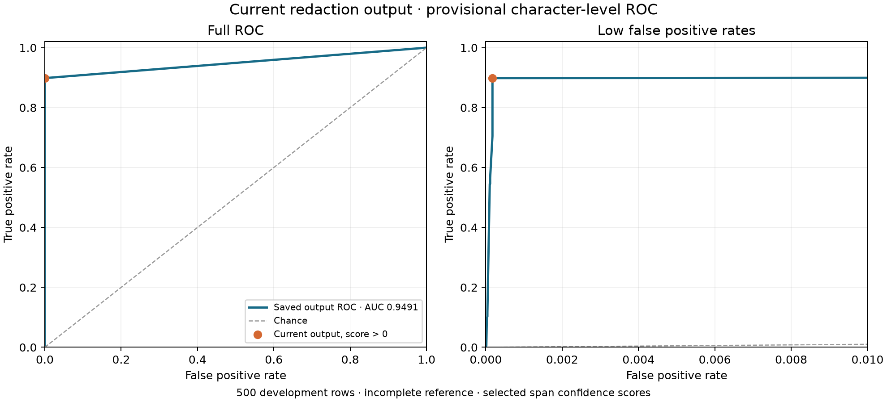

# RedactIQ

Stage 9 detects personal identifiers in English and mixed Indic clinical transcripts and replaces selected spans with typed placeholders. Preserving diagnoses, medications, symptoms, measurements, and ordinary dialogue is part of the redaction contract. The project supports CSV, JSON, text, an API, and a review interface. Clinical accuracy is measured against development references with varying review status.

## Current benchmark results

The latest local rules output was evaluated on **500 development transcripts** with **346 marked PII spans**. It matched 316 marked spans, missed 30, and returned 22 unmatched predictions. The reference annotations are incomplete, so precision and F1 are provisional. These results include supplied semantic tags where present in the input.

| Metric | Current result |
| --- | ---: |
| Exact span F1 | **92.40%** |
| Apparent precision | **93.49%** |
| Recall on marked spans | **91.33%** |
| Character-level ROC AUC | **0.9491** |
| Mean processing time per transcript | **93.90 ms** |
| p95 processing time per transcript | **171.21 ms** |
| Maximum processing time per transcript | **326.04 ms** |
| Transcripts processed within one second | **500 / 500** |

### ROC curve

The ROC curve treats original Unicode characters within marked PII spans as positives and unmarked characters as negatives. Each character receives the highest confidence of a selected span covering it, or zero when uncovered. The curve sweeps those saved scores and ignores entity type. It measures character coverage separately from the exact span scores above. Missing reference annotations and the large number of non-PII characters affect interpretation. The scores describe development performance on the evaluated transcripts.



The detailed local results are saved under `output/first_500_rules_local_20261126_142623_824565/`, with ROC metrics and threshold points in its `roc/` directory.

## Run the local GPU pipeline on Windows

The H2O backend uses **H2O Lightning 4B (`h2oai/h2o-lightning-4b`, Q4_K_M)** through llama.cpp build `b11773`. The GTX 1650 runs all 34 model layers through Vulkan. Presidio, spaCy `en_core_web_sm`, and the rule recognizers run on the CPU. The model server listens on loopback and keeps its weights loaded between Python runs.

From the repository root, with the Python environment and local assets prepared, run a three-row fictional smoke test.

```powershell
python scripts/start_h2o_gpu.py
python -X utf8 main.py --h2o-port 8765 --limit-rows 3
```

Use `--input` for a local clinical file. This command processes the first 500 rows of the benchmark input.

```powershell
python -X utf8 main.py --h2o-port 8765 `
  --input data/input/csv/context_and_semantic_tags.csv --limit-rows 500
```

The launcher reuses the same process when invoked again. On this workstation the warm server uses about 2.8 GiB of VRAM. It stays running until stopped or Windows restarts. To free its memory, use `Stop-Process -Id <printed PID>`. For a port other than 8765, pass `--port` to the launcher and the same value to `--h2o-port`.

## Fast local file processing

Supply `--input` by itself to use the local Presidio and rules path. It uses validated input tags and bounded rules for gap proposals, with no model-server requests.

```powershell
python -X utf8 main.py --input data/input/csv/context_and_semantic_tags.csv --limit-rows 500 --enable-profiling
```

All 500 benchmark rows finished in under one second. The mean was **94 ms**, p95 was **171 ms**, and the maximum was **326 ms**. The updated recognizers preserved the previous 308 exact matches and recovered eight more, reaching **91.33% recall**, **93.49% apparent precision**, and **92.40% apparent F1** on the provisional reference. [Benchmark report](output/first_500_rules_local_20261126_142623_824565/benchmark_first_500.json)

## Setup and local assets

Use a working Windows Python installation. The current benchmark was verified with Python 3.14. Invoke the environment’s Python directly if PowerShell script execution is disabled.

```powershell
python -m venv .venv
$piiPython = '.\.venv\Scripts\python.exe'
& $piiPython -m pip install torch --index-url https://download.pytorch.org/whl/cpu
& $piiPython -m pip install -r config/requirements.windows.txt
& $piiPython -m spacy download en_core_web_sm
& $piiPython -m pip check
```

Use `& $piiPython` in place of `python` in the examples below if the environment isn’t activated. The CPU PyTorch wheel is sufficient for the local H2O path because llama.cpp handles accelerator inference. The requirements file also supports the existing GLiNER and IndicNER entry points.

### Local decision model

| Artifact | Location expected by the launcher |
| --- | --- |
| Windows x64 Vulkan archive `llama-b11773-bin-win-vulkan-x64.zip`, extracted with its DLLs | `.cache/h2o-lightning-runtime/vulkan/llama-server.exe` |
| Publisher’s `h2o-lightning-4b-Q4_K_M.gguf`, GGUF revision `61f8d8b7a8c2d84426d0d143ca187f65d235934b` | `.cache/h2o-lightning-weights/h2o-lightning-4b-Q4_K_M.gguf` |

The expected SHA-256 of the GGUF is `5ec969c6edbad5f1750141742f635cc7f01576bf9432151f730f0a6c30042768`. Use the publisher’s normal Q4_K_M artifact for the native `/v1/systemone` API. The Windows launcher is configured for `Vulkan1`, the GTX 1650 on this workstation, and checks that all layers are offloaded. Check device numbering with `& .\.cache\h2o-lightning-runtime\vulkan\llama-server.exe --list-devices` on other hosts. [H2O.ai GGUF model card](https://huggingface.co/h2oai/h2o-lightning-4b-gguf#how-to-run) · [llama.cpp b11773 release](https://github.com/ggml-org/llama.cpp/releases/tag/b11773)

### Gazetteers and private input

Restore the runtime gazetteers from the pinned data manifest with an authorized Hugging Face account. Use `--check-only` to verify an existing cache. Hugging Face credentials are needed for private asset restoration. Inference through the local H2O server uses no API key.

```powershell
hf auth login
python -m scripts.download_data_assets --group runtime
python -m scripts.download_data_assets --group runtime --check-only
```

The data cache defaults to `.cache/private-data/<revision>/`. Set `PII_DATA_CACHE` to use another cache. If the input CSV is absent at `data/input/csv/context_and_semantic_tags.csv`, use the authorized asset’s resolved cache path.

```powershell
$piiInput = python -m scripts.download_data_assets --group all `
  --print-path data/input/csv/context_and_semantic_tags.csv
if ($LASTEXITCODE -ne 0) { throw 'Private input restore failed.' }
python -X utf8 main.py --h2o-port 8765 --input $piiInput --limit-rows 500
```

Keep a local copy of `DATA_ASSETS.json` at the repository root before restoring data. [Private asset loader](pii_pipeline/data_assets.py)

## Detection and redaction

1. The file runner reads records in order. A CSV uses `context` and can supply `semantic_tags`. Existing tags are treated as input evidence. The pipeline also accepts record-shaped JSON and nonempty TXT lines.
2. Presidio and spaCy assemble candidates. Format checks and contextual recognizers cover medical identifiers, dates, ages, phone numbers, names, addresses, and other identifiers. Validated rule spans bypass H2O.
3. The decision stage verifies weaker candidates and proposes bounded gaps. Numeric gaps require rule evidence. The local pipeline skips verification when a validated input tag agrees with a detected name or location on type and offsets. Validated Telugu tags can also propose whole repetitions for H2O to verify. Out-of-taxonomy candidates go directly to span policy when a confirmation would only annotate the candidate.
4. The shared policy validates offsets, filters clinical and linguistic false positives, combines supporting evidence, and selects non-overlapping spans. `PlaceholderAnonymizer` masks only the selected spans.

Offsets are zero-based, half-open Unicode code-point offsets into the original text. Every selected span obeys `entity['text'] == context[entity['start']:entity['end']]`. The same span conventions apply to the scorer and browser review.

[Decision stage](pii_pipeline/decider_stage.py) · [Presidio orchestrator](pii_pipeline/orchestrator.py) · [Span policy](pii_pipeline/policy/entity_policy.py) · [Pipeline](pii_pipeline/pipeline.py)

## Output and evaluation

Each local H2O CLI run creates `output/first_<limit>_h2o_local_<timestamp>/`. The console prints the exact path. The folder contains these files.

| File | Contents |
| --- | --- |
| `predictions.csv` | `row_index`, original `context`, `gemma_semantic_tags`, `pipeline_entities`, `total_entities_count`, `redacted_text`, and `latency_ms` |
| `pipeline_run_summary.json` | Effective configuration, runtime, model backend, and decision counts |
| `predictions.csv.run_manifest.json` | Run provenance |
| `pipeline_progress.json` | Current progress and latency |
| `stage9_checkpoints/` | Periodic CSV checkpoints |
| `predictions.diagnostics.jsonl` | Candidate and rejection details when diagnostics are enabled |
| `stage_metrics.json` | Stage timings and decision counts by row when `--enable-profiling` is set |

Synthetic runs generate their own reference and automatically score it. For the 500 clinical rows, set `$runDir` to the folder printed by the run and score it against the aligned local reference.

```powershell
$runDir = 'output/first_500_h2o_local_<timestamp>'
python -X utf8 scripts/score_pending_groundtruth.py `
  --reference '500_groundtruth (1).csv' `
  --predictions (Join-Path $runDir 'predictions.csv') `
  --output (Join-Path $runDir 'benchmark_first_500.json')
```

The scorer checks row IDs, text alignment, and original offsets. It reports exact typed matches and typed matches with character IoU of at least 0.50. The clinical reference is incomplete. Recall describes the spans already marked, and apparent precision and F1 treat unmatched predictions as disagreements for review.

Complete CSV files and diagnostic traces contain original text and detected identifiers. Handle them as private data. Redacted text can still contain missed identifiers and requires review before release.

### 23 November 500-row baseline

The run on **23 November 2026** used the first 500 input rows, their supplied semantic tags where present, the aligned 346-span reference, and the already running Vulkan server. It made 177 model requests, matched 265 marked spans, missed 81, and produced 34 unmatched predictions. Exact and IoU ≥ 0.50 scores agreed.

| Metric | Earlier local H2O | Current warm H2O |
| --- | ---: | ---: |
| Mean per-row latency | 7.814 s | **0.488 s** |
| Median per-row latency | 5.096 s | **0.054 s** |
| 95th-percentile latency | 24.818 s | **2.777 s** |
| Rows below one second | 96 / 500 | **401 / 500** |
| GPU model requests | 2,542 | **177** |
| Recall on marked spans | 74.86% | **76.59%** |
| Apparent precision | 51.19% | **88.63%** |
| Apparent F1 | 60.80% | **82.17%** |

The full warm run took **245.98 seconds**. The slowest row took **9.01 seconds**. Names and locations accounted for 70 of the 81 missed marked spans. The same H2O process reused one weight load across separate Python runs. [Baseline report](output/first_500_h2o_local_20261123_170623_730156/benchmark_first_500.json)

### 26 November 500-row run

The updated pipeline preserved the 265 previous exact matches and recovered four names and one address, reaching **78.03% exact recall** on 346 marked spans. It made **156 H2O requests**, with **0.491 s mean**, **2.778 s p95**, and **410 of 500 rows below one second**. Two additional predictions were unmatched in the provisional reference. In the profiled run on the same warm server before tag reuse, the mean was **0.623 s** and p95 was **3.000 s**. [Updated benchmark](output/first_500_h2o_local_20261126_130723_319029/benchmark_first_500.json) · [Stage timings](output/first_500_h2o_local_20261126_130723_319029/stage_latency_summary.csv)

## Other interfaces

| Entry point | Backend and use |
| --- | --- |
| `python main.py --h2o-port 8765` | Local H2O with Presidio. Supply `--input` for batch redaction. |
| `python main.py` | Hosted Flash v1.2 synthetic benchmark through OpenRouter. Requires `PII_ALLOW_HOSTED_DECIDER=1` and `OPENROUTER_API_KEY`; the launcher generates and allowlists its fictional input. |
| `python -m pii_pipeline.run_csv_through_stage9` | Existing configurable local CSV, record-shaped JSON, and TXT runner. Its CLI loads the legacy GLiNER and IndicNER path. |
| `python scripts/run_pipeline.py` | Whole-text and nested JSON runner using the configured legacy pipeline. |
| `python -m pii_pipeline` | FastAPI worker or gateway with the existing configured pipeline. Worker routes include `POST /analyze`, `GET /health`, and `GET /pipeline/metrics`. |
| `python gradio_app.py` | Redaction and saved-run review interface when Gradio is installed. |

## FastAPI endpoints

Start the fast local rules worker from the repository root. It uses the same redaction path as `main.py --input`.

```powershell
$env:PII_SERVICE_ROLE = "rules-worker"
$env:PII_API_HOST = "127.0.0.1"
$env:PII_API_KEY = "replace-with-a-local-secret"
python -m pii_pipeline
```

Open `http://127.0.0.1:8000/docs` for the request schemas. Inference requests require the `X-API-Key` header.

| Method and path | Purpose |
| --- | --- |
| `POST /v1/redact` | Redact one transcript. Supply `text` and optionally `semantic_tags` or `min_entity_score`. |
| `POST /v1/redact/batch` | Redact 1–100 transcripts. Supply an `items` array of single-transcript requests. Results follow input order. |
| `POST /analyze` | Return detailed analysis, including raw detected span values. The rules worker uses the configured NLP language. |
| `GET /health` | Check worker readiness and aggregate API telemetry. |
| `GET /pipeline/metrics` | Read aggregate measurements from the latest saved file run. |

The redaction endpoints return `redacted_text`, `entity_count`, and `latency_ms` per transcript. They accept up to 100,000 characters per item. The latency excludes request validation and time waiting for the worker. The batch endpoint returns an error if an item fails.

From a second terminal with the matching key in `PII_API_KEY`, send a fictional transcript.

```powershell
$body = @{ text = "Patient name: Rina Patel. Age: 41. Reports headache." } | ConvertTo-Json
Invoke-RestMethod http://127.0.0.1:8000/v1/redact -Method Post `
  -Headers @{ "X-API-Key" = $env:PII_API_KEY } -ContentType "application/json" -Body $body
```

The legacy CPU, GPU, and gateway roles continue to serve `/analyze`. Use `PII_CONFIG_PATH` to select a config. To provision or verify legacy model assets, supply a local `MODEL_ASSETS.json` and run `python scripts/download_model_assets.py --check-only --verify-sha256`. The Gradio interface needs a local copy of `gradio_app.py`. [API implementation](pii_pipeline/api_endpoint.py)

## Testing and source notes

Install `pytest` in the Python environment if needed. The browser review test uses Node.js.

```powershell
python -X utf8 -m pytest -q tests/pipeline tests/detection tests/models tests/benchmark
node tests/review/test_browser_review.cjs
```

The latest Python regression run passed **991 tests**. Browser review tests have a separate command above. `scripts/benchmark_configured_pipeline.py` measures a selected legacy configuration. `scripts/synthetic_hindi/` supplies the deterministic Hindi test cases. Both live outside the ignored documentation tree.

The local pipeline guide, knowledge transfer notes, and Word project report document the operating contract, earlier recognizers, and historical results. The local Decider migration plan and Flash hardware notes describe the proposed Perplexity migration and its serving constraints. Use the runtime table and measured benchmark above for the current backend and performance.

Git keeps this README, implementation, configuration, launchers, and tests. Other Markdown, reports, private data, model weights, and generated outputs stay local under `.gitignore`. A fresh checkout needs the private asset manifests and provisioned assets before inference. [Ignore rules](.gitignore)
